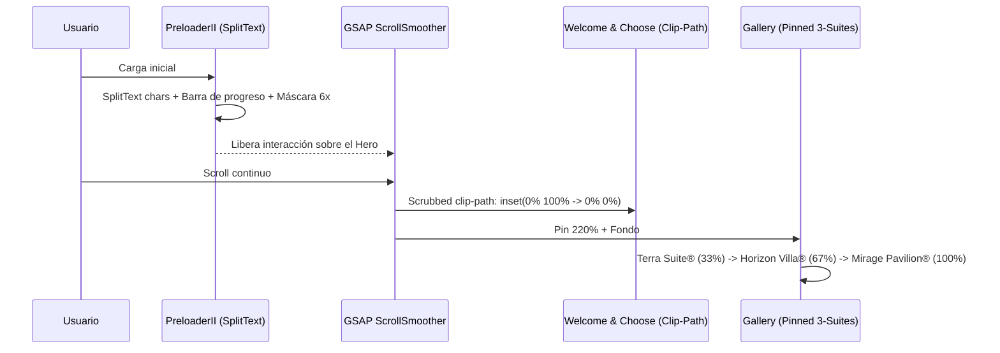

# SOLTERRA® — Arquitectura Técnica Detallada

Esta guía documenta la ingeniería de **SOLTERRA®**: cómo se orquestan **React 19**, **Vite 6**, **Tailwind CSS 4** y **GSAP 3.13** (`ScrollSmoother`, `ScrollTrigger`, `SplitText`) para lograr una experiencia editorial arquitectónica a **60 FPS** con la paleta **Midnight Botanical Pine**.

---

## 1. Flujo de Scroll &amp; Coreografía GSAP

Toda la página vive dentro de un contenedor **`ScrollSmoother`** acelerado por GPU. Esto garantiza que cada animación vinculada al scroll (`ScrollTrigger`) comparta la misma curva de inercia sin saltos entre mouse wheel, trackpad y móvil.

---

## 2. Módulos Clave de Animación

### A. Preloader con `SplitText` y Máscara Expansiva
- Divide el wordmark `SOLTERRA` en caracteres enmascarados y el tagline en líneas enmascaradas.
- Ejecuta una barra de progreso en 3 pasos orgánicos y finalmente escala `.preloader-mask` a `6x` con `power3.out` para descubrir el Hero con humo ambiental.

### B. Tipografía Dual con `clip-path` (`Welcome` &amp; `Choose`)
- Cada línea renderiza una base en **Pine Mist (`#2D4239`)** y una copia superpuesta en **Warm Limestone (`#F3EFE6`)**.
- `ScrollTrigger` anima secuencialmente `clipPath: "inset(0% 0% 0% 0%)"` mientras el usuario lee, logrando un efecto editorial de tinta iluminada a 60 FPS.

### C. Galería Full-Bleed Fijada (`Gallery`)
- Fija el viewport (`pin: true`, `scrub: 1`) y transiciona el fondo de **Deep Moss (`#1C2E26`)** a **Midnight Pine (`#0B1310`)**.
- Expande la primera suite (**Terra Suite®**) a pantalla completa con bordes redondeados (`3.5rem`) y encadena **Horizon Villa®** y **Mirage Pavilion®** con profundidad `scale(0.9)` y barra de progreso en **Sunset Terracotta (`#E07A5F`)**.

### D. Columnas Editorial Sticky (`StickyCols`)
- Combina columnas fijadas con parallax suave de fotografía arquitectónica para resaltar materiales y luz natural.

---

## 3. Sistema de Diseño Midnight Botanical Pine

| Token | Hex | Función |
| :--- | :--- | :--- |
| **Midnight Pine** | `#0B1310` | Fondo principal profundo y texto sobre botones claros/terracota |
| **Smoked Sage** | `#14211C` | Navbar flotante, pills interactivos y superficies elevadas |
| **Deep Moss** | `#1C2E26` | Transición inicial de galería y profundidad orgánica |
| **Warm Limestone** | `#F3EFE6` | Titulares principales y texto revelado |
| **Sage Sand** | `#9EB3A7` | Párrafos editoriales y subtítulos secundarios |
| **Sunset Terracotta** | `#E07A5F` | CTA principal (`ReserveBtn`), acento `®` y barras de progreso |
| **Desert Amber** | `#F2CC8F` | Hover cálido en botones y pills activos |
| **Pine Mist** | `#2D4239` | Bordes sutiles, base de texto sin revelar y pistas de progreso |

---

## 4. Carpeta Pública de Visuales (`solterra/`)

La carpeta [`./solterra/`](./solterra/) reúne los assets públicos de identidad y fotografía arquitectónica:
- `logo.svg`, `favicon.svg` y `solterra-preview.gif`
- `cap1.png`, `hero-mobile.png` (Hero escritorio y móvil)
- `background1.png`, `background2.png`, `background3.png` (*Terra Suite®*, *Horizon Villa®*, *Mirage Pavilion®*)
- `welcome-1.png`, `welcome-2.png`, `cap1-square.jpg`, `cap2-square.jpg` (Estudios de patio y detalles arquitectónicos)

---

> 🔒 ¿Quieres acceder al código fuente completo en **`annoris/solterra-pro`**? Consulta **[`CONTRIBUTING.md`](./CONTRIBUTING.md)**.
