<div align="center">
  

  <h1>SOLTERRA® — Architectural Desert Sanctuaries</h1>

  <p>
    <strong>GSAP 3.13 ScrollSmoother + SplitText Mask Preloader + Dual-Layer Clip-Path Typography + Full-Bleed Pinned 3-Suite Gallery in React 19, Vite 6 &amp; Tailwind CSS 4 — Built for 60 FPS Awwwards-Level Hospitality.</strong>
  </p>
  <p>
    <sub><em>Closer to Earth—Closer to Stillness · Santuarios Arquitectónicos en el Desierto · Paleta Midnight Botanical Pine</em></sub>
  </p>

  <p>
    <a href="https://annoris.github.io/solterra/">
      
    </a>
    <a href="https://github.com/annoris/solterra/stargazers">
      
    </a>
    <a href="https://github.com/annoris/solterra/network/members">
      
    </a>
    <a href="https://github.com/annoris/solterra/issues">
      
    </a>
    <br />
    
    
    
    
    
  </p>

  <p>
    <a href="#-whats-inside-the-engine-curiosity-teasers">Engine Teasers</a> ·
    <a href="#-performance--architecture-scorecard">Scorecard</a> ·
    <a href="#-explore-the-public-solterra-visual-vault">Visual Vault (<code>solterra/</code>)</a> ·
    <a href="./ARCHITECTURE.md">Architecture Deep-Dive</a> ·
    <a href="#-unlock-annorissolterra-pro-full-downloadable-source-code">Unlock <code>solterra-pro</code></a>
  </p>
</div>

---

<div align="center">
  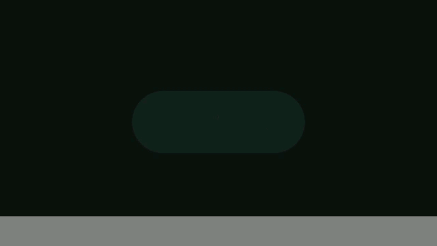
  <br />
  <h3>⭐ Star this repo if you love GSAP 3.13, ScrollSmoother &amp; Awwwards-Level Editorial UI!</h3>
  <sub><em>Si te inspira el diseño editorial arquitectónico, GSAP 3.13 y React 19, deja tu ⭐ arriba — impulsa el proyecto y ayuda a que más devs y diseñadores lo descubran.</em></sub>
</div>

---

## 🔥 What's Inside the Engine (Curiosity Teasers)

Click any module below to peek under the hood of **SOLTERRA®**'s motion &amp; design engine — real production patterns distilled without spoiling the full codebase:

<details>
<summary><strong>🎬 1. GSAP 3.13 <code>ScrollSmoother</code> + <code>SplitText</code> Character Mask Preloader</strong></summary>

<br />

The opening sequence splits `SOLTERRA` into masked character slices and runs a 3-step organic progress bar before scaling a viewport mask to `6x` to unveil the desert hero with ambient smoke blending:

```js
const splits = SplitText.create(".preloader-logo h1", {
  type: "chars",
  mask: "chars",
  charsClass: "char",
});

tl.to(splits.chars, { x: "0%", stagger: 0.05, duration: 1, ease: "power4.inOut" })
  .to(".preloader-mask", { scale: 6, duration: 4, ease: "power3.out" }, "<");
```

Zero layout thrash, GPU-composited transforms, and instant handoff into `ScrollSmoother`.

</details>

<details>
<summary><strong>✒️ 2. Dual-Layer <code>clip-path</code> Scroll-Scrubbed Typography Reveal</strong></summary>

<br />

In `Welcome` and `Choose`, every line is rendered in two stacked layers: a quiet **Pine Mist (`#2D4239`)** base and an illuminated **Warm Limestone (`#F3EFE6`)** overlay revealed via scrubbed `clip-path: inset(...)`:

```js
lines.forEach((line) => {
  tl.to(line, {
    clipPath: "inset(0% 0% 0% 0%)",
    ease: "none",
    stagger: 0.2,
    duration: 1,
  });
});
```

Scrolling literally paints light across each sentence with tactile, sub-pixel precision.

</details>

<details>
<summary><strong>🏛️ 3. Full-Bleed Pinned 3-Suite Gallery Scrubbing (<code>Deep Moss → Midnight Pine</code>)</strong></summary>

<br />

The pinned `Gallery` section orchestrates a 3-act architectural reveal (**Terra Suite® → Horizon Villa® → Mirage Pavilion®**) while morphing the entire canvas from `#1C2E26` to `#0B1310` and advancing a **Sunset Terracotta (`#E07A5F`)** progress bar (`33% → 67% → 100%`):

```js
tl4
  .to(".gallery-page4", { backgroundColor: "#0B1310" }, "start")
  .to(".gallery-background", { width: "calc(100vw - 1rem)", height: "calc(100vh - 1rem)", borderRadius: "3.5rem" }, "a")
  .to("#gallery-second", { transform: "translate(-50%, -56%)" }, "b")
  .to("#gallery-third", { transform: "translate(-50%, -56%)" }, "c");
```

</details>

<details>
<summary><strong>🌿 4. Midnight Botanical Pine Design System (8 Curated Tokens)</strong></summary>

<br />

Every surface, border, and hover state follows a strict 8-color architectural hierarchy inspired by desert twilight and botanical pine:

- **Midnight Pine** `#0B1310` · **Smoked Sage** `#14211C` · **Deep Moss** `#1C2E26`
- **Warm Limestone** `#F3EFE6` · **Sage Sand** `#9EB3A7` · **Pine Mist** `#2D4239`
- **Sunset Terracotta** `#E07A5F` · **Desert Amber** `#F2CC8F`

</details>

---

## 📊 Performance &amp; Architecture Scorecard

| Metric / Pillar | Result | Engineering Highlights |
| :--- | :---: | :--- |
| **Scroll &amp; Motion Frame Rate** | **60 FPS Locked** | GSAP 3.13 `ScrollSmoother` + GPU-composited `clip-path` &amp; `transform` timelines |
| **Build Tooling** | **Vite 6 + React 19** | Sub-second HMR and ultra-lean production bundle |
| **Styling Engine** | **Tailwind CSS 4** | Zero-bloat utility tokens tuned to the Midnight Botanical Pine palette |
| **Brand &amp; Visual Identity** | **100% Bespoke** | Custom vector `logo.svg` + `favicon.svg` + 9 architectural desert photographs |
| **Responsive Choreography** | **Desktop &amp; Mobile** | Adaptive line-break arrays (`LG` / `SM`) so `clip-path` reveals stay razor-aligned |

---

## 🧠 System Architecture

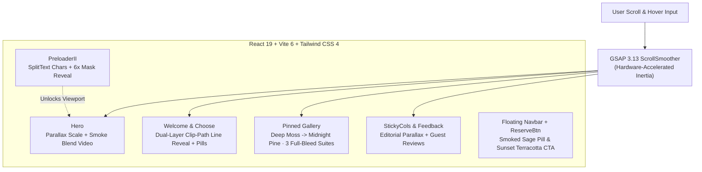

> 📖 Read the full technical breakdown in **[`ARCHITECTURE.md`](./ARCHITECTURE.md)**.

---

## 🎨 Explore the Public `solterra/` Visual Vault

All architectural photography and bespoke SVG brand assets are **openly browsable inside [`./solterra/`](./solterra/)** — explore the folder freely to inspect the **SOLTERRA®** visual direction:

### Hero &amp; Architectural Patios

| Desert Hero (`solterra/cap1.png`) | Courtyard Stillness (`solterra/welcome-1.png`) | Desert Horizon (`solterra/welcome-2.png`) |
| :---: | :---: | :---: |
| 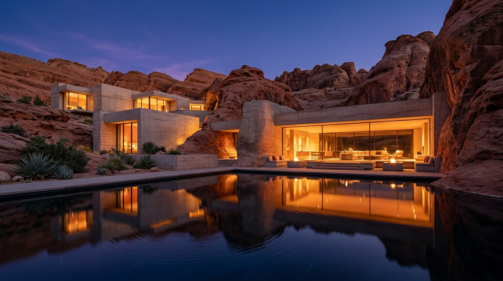 | 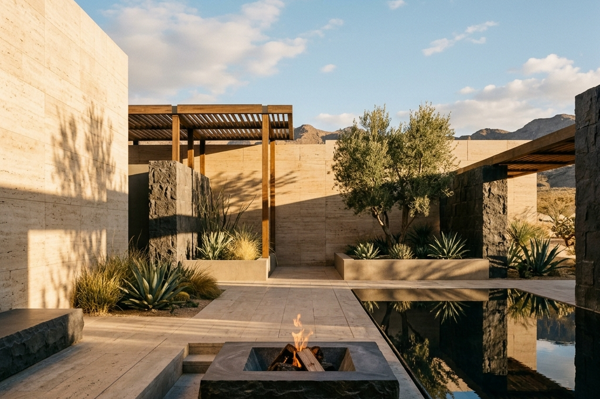 | 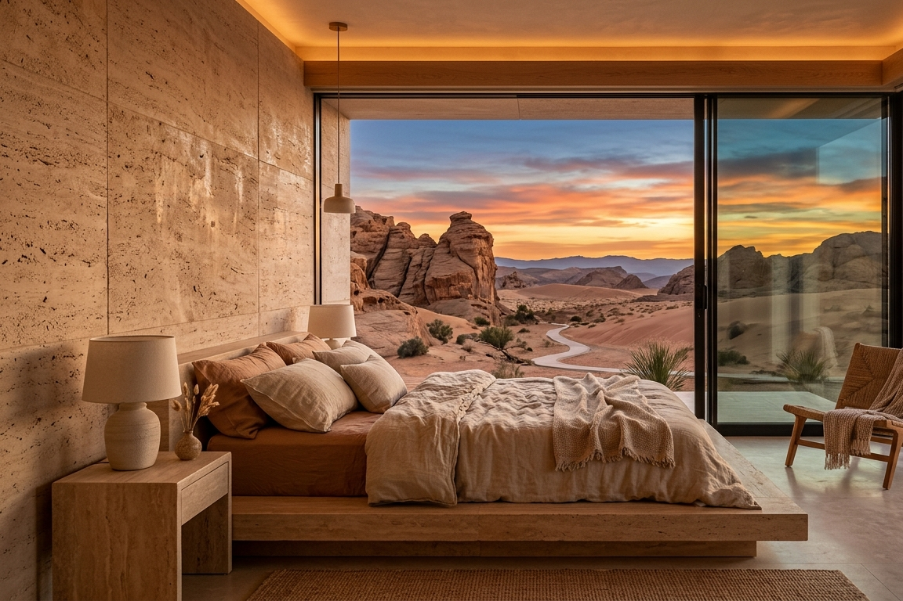 |

### 3 Signature Sanctuaries

| Sanctuary | Architectural Concept | Preview (`./solterra/`) |
| :--- | :--- | :---: |
| **Terra Suite®** | Raw earth warmth meets panoramic desert glass — an intimate sanctuary built for quiet restoration. | 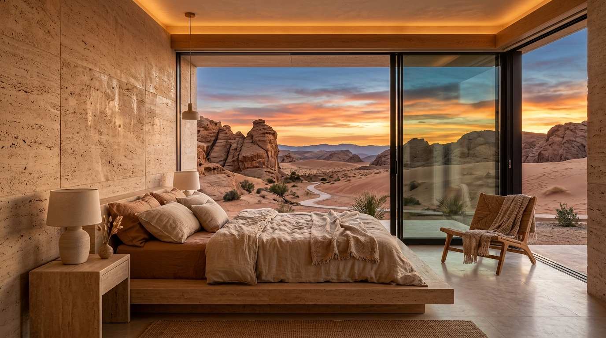 |
| **Horizon Villa®** | Private cantilevered terrace and soaking deck framing uninterrupted golden-hour views across the valley. | 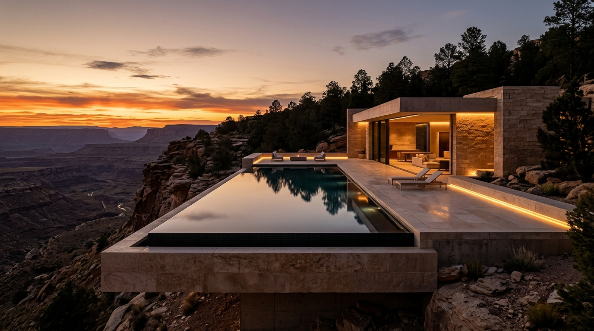 |
| **Mirage Pavilion®** | Desert minimalism with expansive glass walls, skylight stargazing, and complete horizon seclusion. | 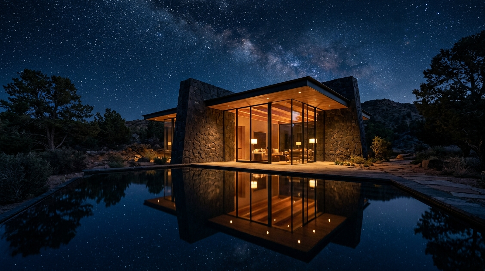 |

### Editorial Details

| Square Study I (`solterra/cap1-square.jpg`) | Square Study II (`solterra/cap2-square.jpg`) | Mobile Hero (`solterra/hero-mobile.png`) |
| :---: | :---: | :---: |
| 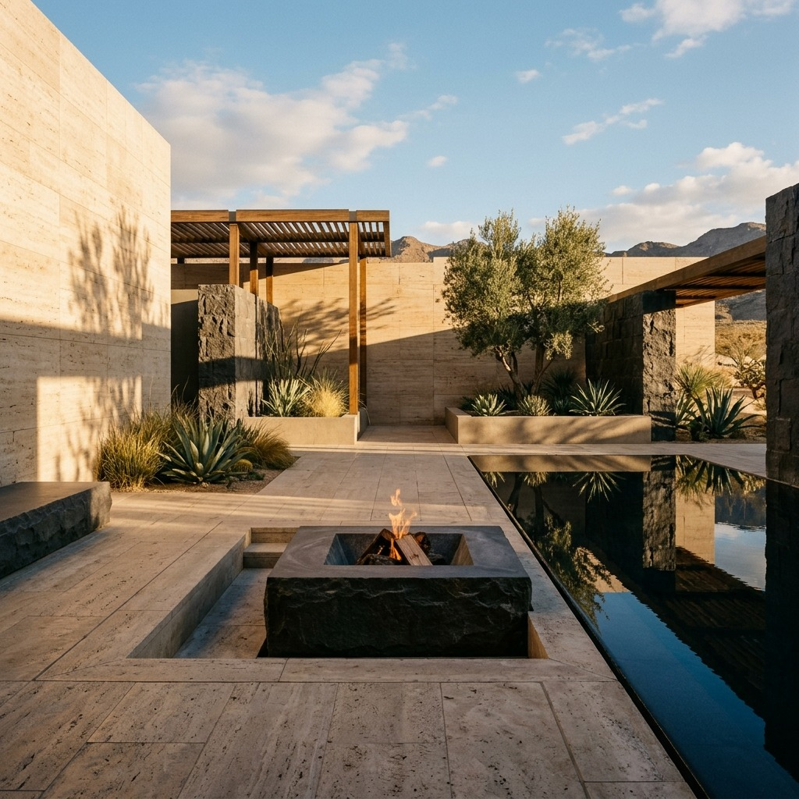 | 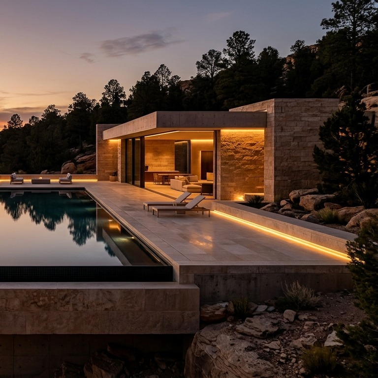 | 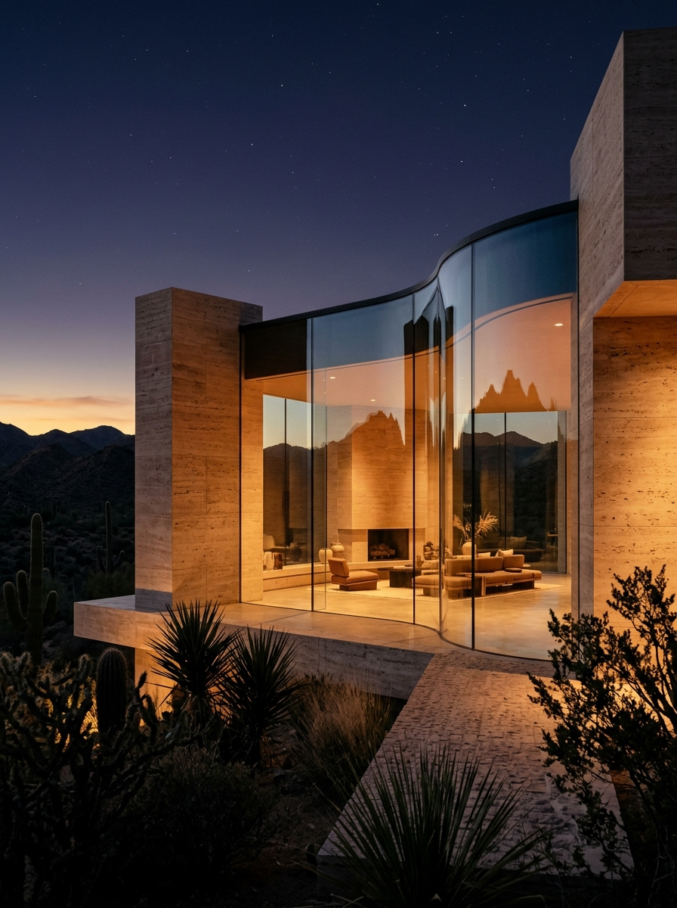 |

---

## 🔒 Unlock `annoris/solterra-pro` (Full Downloadable Source Code)

This public repository (**[`annoris/solterra`](https://github.com/annoris/solterra)**) shares the **architecture, live GIF preview, GSAP engine teasers, and the public [`solterra/`](./solterra/) visual vault**.

The **complete, production-ready, downloadable source code** (React 19 + Vite 6 + Tailwind CSS 4 + GSAP 3.13 `ScrollSmoother` / `ScrollTrigger` / `SplitText` components and build pipeline) lives in the private repository **`annoris/solterra-pro`**.

### 🏆 Contribute-to-Unlock Model (*Acceso Exclusivo para Contribuidores*)

We reward builders who add value to the community. **Star this repo and complete any one of these paths to receive an official GitHub collaborator invite to `annoris/solterra-pro`:**

1. **🛠️ Submit a Valuable Pull Request** to [`annoris/solterra`](https://github.com/annoris/solterra) — GSAP/ScrollSmoother guides, architecture diagrams, performance tips, or translations.
2. **🧠 Open a High-Signal Technical Issue** in [`annoris/solterra/issues`](https://github.com/annoris/solterra/issues) — deep UX/motion audit, accessibility improvements, or creative architecture proposals.
3. **🤝 Direct Collaboration / Sponsorship** — follow **[`CONTRIBUTING.md`](./CONTRIBUTING.md)** with your GitHub handle.

👉 **Read [`CONTRIBUTING.md`](./CONTRIBUTING.md) for the step-by-step invite process.**

---

## 📣 Share SOLTERRA®

Love GSAP 3.13, editorial architecture, and 60 FPS interactive hospitality UI? Share **SOLTERRA®**:

<div align="center">
  <a href="https://twitter.com/intent/tweet?text=Just%20discovered%20SOLTERRA%C2%AE%20%E2%80%94%20GSAP%203.13%20ScrollSmoother%20%2B%20SplitText%20Preloader%20%2B%20Dual-Layer%20Clip-Path%20Typography%20%2B%20Full-Bleed%20Pinned%20Gallery%20in%20React%2019%20%26%20Tailwind%204%20%F0%9F%8C%B5%E2%9C%A8&url=https%3A%2F%2Fgithub.com%2Fannoris%2Fsolterra&hashtags=GSAP,React19,TailwindCSS,WebDesign,CreativeCoding">
    
  </a>
  &nbsp;
  <a href="https://www.linkedin.com/sharing/share-offsite/?url=https%3A%2F%2Fgithub.com%2Fannoris%2Fsolterra">
    
  </a>
  &nbsp;
  <a href="https://github.com/annoris/solterra/stargazers">
    
  </a>
</div>

<br />

<div align="center">
  <sub><strong>SOLTERRA®</strong> · Closer to Earth—Closer to Stillness · California Desert Architectural Sanctuaries</sub>
</div>

---

## 🌐 Explore the JAP INTERNATIONAL & Annoris Ecosystem

Built by **JAP INTERNATIONAL** — Local-First AI Automation Platforms for Small & Medium Businesses (SMBs), agencies, clinics, e-commerce, and enterprise teams, alongside 60 FPS Creative Web Engineering showcases. Every project below includes an instant **Live Demo (zero login required)**.

### 🤖 AI & Local-First Business Automation
| Project | What It Solves | Stack | Live Demo |
| :--- | :--- | :--- | :---: |
| [**`aetheris`**](https://github.com/annoris/aetheris) | 77 AI Agents, 328 Skills & Local-First Automation Control Plane | Bun · Node · Ollama · MCP | [Live Demo ↗](https://annoris.github.io/aetheris/) |
| [**`aurelia`**](https://github.com/annoris/aurelia) | Self-Hosted Business AI Automation, RAG, Workflows & Local CRM | React 18 · Express · Prisma | [Live Demo ↗](https://annoris.github.io/aurelia/) |
| [**`lumenpitch`**](https://github.com/annoris/lumenpitch) | AI Presentation Studio & Multi-LLM Slide Generation Engine | Next.js 16 · FastAPI · Electron | [Live Demo ↗](https://annoris.github.io/lumenpitch/) |
| [**`tabvento`**](https://github.com/annoris/tabvento) | Autonomous AI Browser Automation Dashboard (Local-First BYOK) | Python · Playwright · SQLite | [Live Demo ↗](https://annoris.github.io/tabvento/) |
| [**`trading-bauhaus-journal`**](https://github.com/annoris/trading-bauhaus-journal) | AI Trading Journal with Claude/OpenAI Analyst & OHLC Replay | Next.js 15 · TypeScript · SQLite | [Live Demo ↗](https://annoris.github.io/trading-bauhaus-journal/) |

### 🎨 Creative Engineering & 60 FPS Web Showcases
| Project | Experience & Motion Engineering | Stack | Live Demo |
| :--- | :--- | :--- | :---: |
| [**`kairo`**](https://github.com/annoris/kairo) | 60 FPS Spatial Web: Navier-Stokes Fluid, GLSL Shaders & Rapier 3D | Next.js 14 · Three.js · GLSL | [Live Demo ↗](https://annoris.github.io/kairo/) |
| [**`valence`**](https://github.com/annoris/valence) | Zero-Bundler 60 FPS Awwwards Agency Template (MIT) | HTML5 · CSS3 · GSAP · Lenis | [Live Demo ↗](https://annoris.github.io/valence/) |
| [**`luma`**](https://github.com/annoris/luma) | Zero-Dependency Botanical Brand Experience + 106 BPM Web Audio Synth | HTML5 · CSS3 · Web Audio API | [Live Demo ↗](https://annoris.github.io/luma/) |
| [**`valtor`**](https://github.com/annoris/valtor) | Luxury Automotive Digital Flagship — 60 FPS GSAP + SplitText | Vite · ES Modules · GSAP | [Live Demo ↗](https://annoris.github.io/valtor/) |
| **`solterra`** *(You are here)* | Luxury Desert Architecture Showcase — GSAP ScrollSmoother | React 19 · Vite 6 · Tailwind 4 | [Live Demo ↗](https://annoris.github.io/solterra/) |
| [**`moxie`**](https://github.com/annoris/moxie) | Bold Social-First Creative Agency Experience — GSAP Inertia | Next.js 15 · React 19 · Lenis | [Live Demo ↗](https://annoris.github.io/moxie/) |
| [**`kineta`**](https://github.com/annoris/kineta) | Locked-60fps Brutalist Editorial Showcase & Variable Font Physics | Vanilla JS · GSAP · Lenis | [Live Demo ↗](https://annoris.github.io/kineta/) |
| [**`solmora`**](https://github.com/annoris/solmora) | Editorial Mediterranean E-Commerce Showcase (MIT, Zero-Deps) | HTML5 · CSS3 · Vanilla JS | [Live Demo ↗](https://annoris.github.io/solmora/) |

> ⭐ **Enjoyed exploring this project?** Drop a **Star** on GitHub and check out the full portfolio at [**github.com/annoris**](https://github.com/annoris) — it helps other builders discover the ecosystem!
